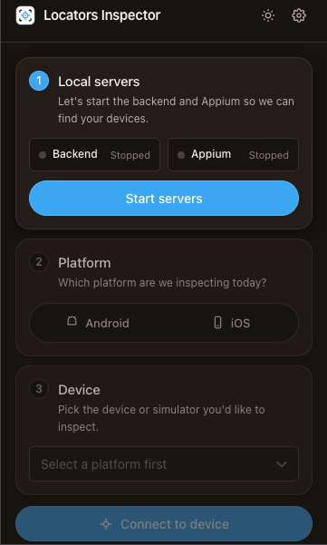
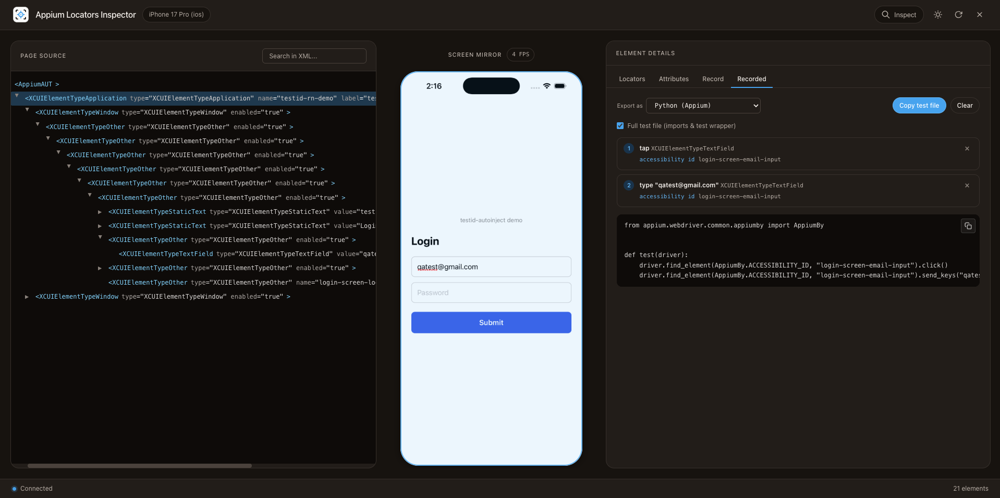
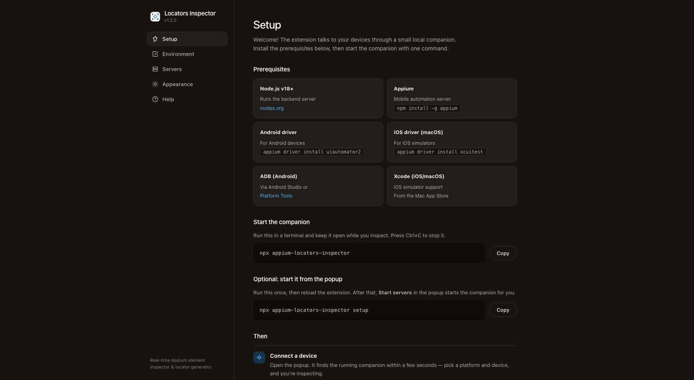

<div align="center">


# Appium Locators Inspector

**Inspect Android & iOS apps via Appium — live UI tree, ranked locators, and record actions into runnable Java / Python / TypeScript tests.**

[](https://chromewebstore.google.com/detail/appium-locators-inspector/annejeomdlkidljonmpmhcdnekkadjfb)
[](LICENSE)


**[⬇️ Install from the Chrome Web Store](https://chromewebstore.google.com/detail/appium-locators-inspector/annejeomdlkidljonmpmhcdnekkadjfb)**


</div>

---

## Overview

**Appium Locators Inspector** is a Chrome extension (plus a small local companion) that turns Appium into a fast, visual workflow. Mirror a real device or simulator, browse its UI tree, get the **best, verified locator** for any element, and **record your taps and gestures into a runnable test** — without leaving the browser, and 100% on your machine.

Built for QA and mobile automation engineers who want to stop hand-writing brittle XPaths.

## See It in Action

https://github.com/user-attachments/assets/c992b6ef-2318-42ab-8d90-824c9413fa41

## Features

- 📱 **Live device mirror + element tree** — inspect real Android & iOS apps in real time.
- 🎯 **Ranked, verified locators** — every candidate is matched against the page source; the unique, non-brittle one is marked **Recommended**, fragile ones flagged **Brittle**.
- 🧩 **Multiple strategies** — accessibility id, resource-id, UiAutomator2, iOS predicate string & class chain, XPath.
- 📋 **Copy as code** — one click to grab any locator as **Java**, **Python**, or **TypeScript (WebdriverIO)**.
- ⏺ **Record → runnable test** — tap through your app; each action becomes a step, exported as a complete test file.
- ✋ **Full gesture set** — tap, double-tap, long-press, swipe, pinch, type, clear, plus built-in **assertions** (visible / hidden / enabled / disabled / checked / unchecked / empty).
- 🩺 **Environment doctor** — a one-click preflight for Node, Appium, drivers, adb, Java & Xcode.
- 🌗 **Light & dark themes** — a quiet, editorial UI that stays readable either way.
- 🔒 **100% local** — nothing leaves your machine. No accounts, no telemetry.

## A Closer Look

| Popup — connect flow | Inspector — inspect & locate |
| --- | --- |
|  |  |

| Record — capture actions | Recorded — export a test |
| --- | --- |
|  |  |

<div align="center"></div>

## Requirements

- **Node.js** 18+
- **Appium** 3.x
- Appium drivers: **uiautomator2** (Android) and/or **xcuitest** (iOS)
- **Android:** Android SDK with `adb` on your `PATH`, and a **JDK** with `JAVA_HOME` set
- **iOS (macOS only):** **Xcode** with command-line tools

> Not sure what you have? The extension's **Settings → Environment** runs a built-in doctor that reports versions and paths for everything above.

## Installation

**1. Install the extension**

Install it from the [Chrome Web Store](https://chromewebstore.google.com/detail/appium-locators-inspector/annejeomdlkidljonmpmhcdnekkadjfb).

<details>
<summary>Or build it from source</summary>

```bash
git clone https://github.com/JulianWangHZ/Appium-Locators-Inspector.git
cd Appium-Locators-Inspector
npm install
npm run build
```

Open `chrome://extensions`, enable **Developer mode**, click **Load unpacked**, and select the `dist/extension/` folder.

</details>

**2. Start the local companion**

```bash
npx appium-locators-inspector
```

Keep the terminal open while you inspect; press Ctrl+C to stop. It starts the local backend, and Appium too if it isn't already running. The popup picks it up within a few seconds.

Prefer a button? Run `npx appium-locators-inspector setup` once and reload the extension. After that, **Start servers** in the popup starts the companion for you. `npx appium-locators-inspector uninstall` undoes it.

## Getting Started

1. Run `npx appium-locators-inspector`, then click the toolbar icon to open the popup.
2. Make sure the servers show **Running** → pick a **platform** → pick a **device / simulator** → **Connect**.
3. The **Inspector** opens: the device mirror in the middle, the **Page Source** tree on the left, **Element Details** on the right.
4. **Tap any element** to see its attributes and ranked locators. Copy the **Recommended** one, or **Copy as** Java / Python / TypeScript.
5. Switch to the **Record** tab: tap an element, then choose an action (Click, Double tap, Swipe, Type…) or an assertion. Steps appear live.
6. Open **Recorded** to preview and copy the full test.

## Exporting Tests

Recorded flows export as a complete, runnable test in your framework of choice.

**TypeScript (WebdriverIO)**

```typescript
import { $, expect } from '@wdio/globals';

describe('test', () => {
  it('test', async () => {
    await $('~username').setValue('test@example.com');
    await $('~login').click();
    await expect($('~home')).toBeDisplayed();
  });
});
```

**Python (Appium)**

```python
from appium.webdriver.common.appiumby import AppiumBy


def test(driver):
    driver.find_element(AppiumBy.ACCESSIBILITY_ID, "username").send_keys("test@example.com")
    driver.find_element(AppiumBy.ACCESSIBILITY_ID, "login").click()
    assert driver.find_element(AppiumBy.ACCESSIBILITY_ID, "home").is_displayed()
```

**Java (Appium)**

```java
driver.findElement(AppiumBy.accessibilityId("username")).sendKeys("test@example.com");
driver.findElement(AppiumBy.accessibilityId("login")).click();
assertTrue(driver.findElement(AppiumBy.accessibilityId("home")).isDisplayed());
```

## Environment Check

**Settings → Environment** runs a doctor-style preflight so you can fix setup problems before connecting. It reports:

- Node.js, Appium, and installed drivers (uiautomator2 / xcuitest)
- Java and `JAVA_HOME`
- `adb` and `ANDROID_HOME`
- Xcode, `xcrun`, and available iOS simulators
- Backend status

Each row shows a version or path, so you know exactly what's missing.

## Architecture

Everything runs locally — the extension never talks to a remote server.

```
Chrome Extension                     npx appium-locators-inspector
      │                                (or the native host, after `setup`)
      │                                        │
 Inspector UI  ◀── screen + page source ──  Local Backend  (:8765)
                                               │
                                               ▼
                                       Appium  (:4723)  ──▶  Device / Simulator
```

- **Extension** — the UI (popup, inspector, settings), Manifest V3.
- **Companion** — the npm package `appium-locators-inspector`: the backend plus a CLI that starts it (and Appium) in your terminal.
- **Native host** — optional; registered by `setup` so Chrome can start the companion from the popup.
- **Backend** — a local Node server that drives Appium, streams the screen, and returns the page source.
- **Appium** — performs the actual taps, gestures, and element queries on the device.

The backend listens on `127.0.0.1` only and accepts requests from extension pages, not from web pages.

### Source layout

Everything is TypeScript, bundled with esbuild into `dist/`.

```
src/
  shared/        types and helpers used by every part (protocol, FPS, validation)
  extension/     Manifest V3 extension: background/, popup/, options/, logs/, inspector/, lib/
  backend/       local server: HTTP routes, WebSocket stream, minimal WebDriver client
  native-host/   launcher started by Chrome; supervises the backend and Appium
  cli/           `npx appium-locators-inspector`: start, setup, uninstall
tests/           unit, integration, end-to-end and UI parity tests
scripts/         build (dist/extension, dist/npm) and extension packaging
```

## Troubleshooting

| Issue | Fix |
| --- | --- |
| Popup says the companion isn't running | Run `npx appium-locators-inspector` and keep the terminal open. |
| "Native messaging host not found" | Only needed for the popup's Start button: run `npx appium-locators-inspector setup`, then reload the extension. |
| Port 8765 already in use | Another companion is running. Stop it, or use `--port` and set the same port in Settings. |
| Appium installed somewhere unusual | Set `APPIUM_PATH` to the Appium binary. Appium's log is in `~/.appium_locators_inspector/appium.log` (or use `--verbose`). |
| Appium not found | `npm install -g appium` |
| No Android devices | Run `adb devices`; enable USB debugging. |
| No iOS simulators | Boot a simulator in Xcode (macOS only). |
| iOS real device: WebDriverAgent signing fails | Export your Apple Developer Team ID before starting the companion: `export APPLE_TEAM_ID=XXXXXXXXXX`. Simulators need no signing. |

The companion logs to its terminal; when started from the popup, logs go to `~/.appium_locators_inspector/`.

## Contributing

Contributions are welcome! Please open an issue to discuss significant changes first.

1. Fork the repo and create a feature branch.
2. Run `npm install`, then `npm run build`, and load `dist/extension/` unpacked.
3. After each change, run `npm run build` again and reload the extension.
4. Run `npm run typecheck` and `npm test` (with `--coverage` for the coverage report).
5. Open a pull request with a clear description.

| Command | What it does |
| --- | --- |
| `npm run build` | Builds `dist/extension` (Chrome) and `dist/npm` (the companion package). |
| `npm run companion` | Builds, then runs the companion from `dist/npm` (same as the npx command). |
| `npm run backend` | Builds, then runs only the backend (`PORT`, `APPIUM_PORT` env vars). |
| `npm run package:extension` | Builds, then zips `dist/extension` for the Chrome Web Store. |
| `npm run publish:companion` | Builds, then publishes `dist/npm` to npm (needs `npm login`). |
| `npm test` | Runs all tests, including UI parity tests against the pre-TypeScript pages in `tests/legacy/`. |

## Acknowledgements

Inspired by [taqwright](https://github.com/taqelah/taqwright) and [Appium Inspector](https://github.com/appium/appium-inspector).

## License

[MIT](LICENSE) © 2026 Julian Wang
