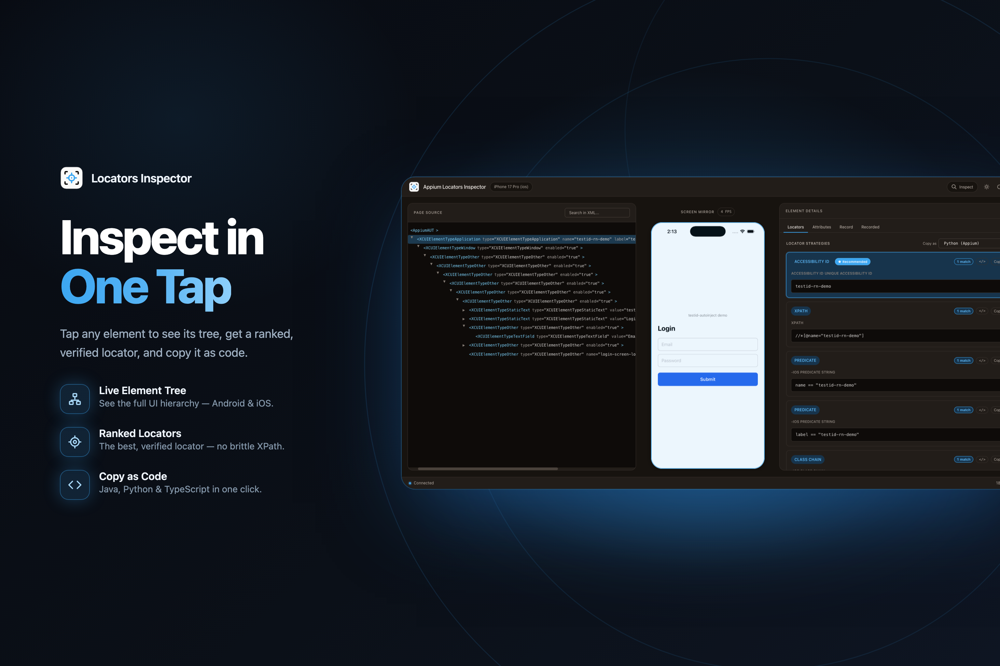
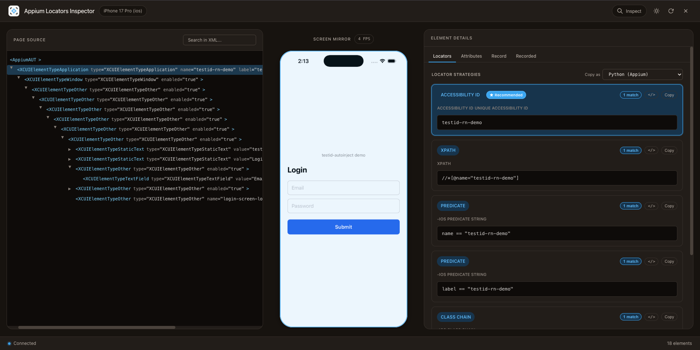
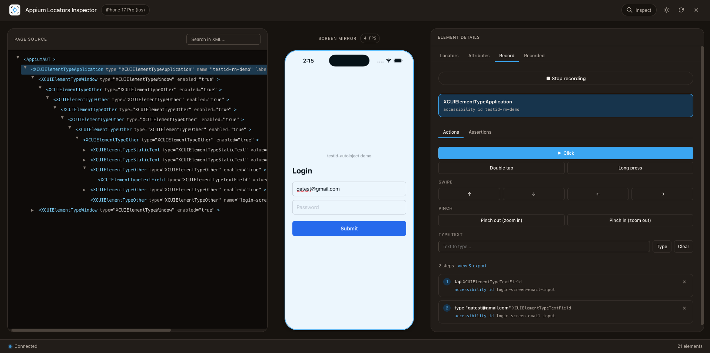

<div align="center">


# Appium Locators Inspector

**Inspect Android & iOS apps via Appium — live UI tree, ranked locators, and record actions into runnable Java / Python / TypeScript tests.**

[](LICENSE)




</div>

---

## Overview

**Appium Locators Inspector** is a Chrome extension (plus a small local companion) that turns Appium into a fast, visual workflow. Mirror a real device or simulator, browse its UI tree, get the **best, verified locator** for any element, and **record your taps and gestures into a runnable test** — without leaving the browser, and 100% on your machine.

Built for QA and mobile automation engineers who want to stop hand-writing brittle XPaths.

## Features

- 📱 **Live device mirror + element tree** — inspect real Android & iOS apps in real time.
- 🎯 **Ranked, verified locators** — every candidate is matched against the page source; the unique, non-brittle one is marked **Recommended**, fragile ones flagged **Brittle**.
- 🧩 **Multiple strategies** — accessibility id, resource-id, UiAutomator2, iOS predicate string & class chain, XPath.
- 📋 **Copy as code** — one click to grab any locator as **Java**, **Python**, or **TypeScript (WebdriverIO)**.
- ⏺ **Record → runnable test** — tap through your app; each action becomes a step, exported as a complete test file.
- ✋ **Full gesture set** — tap, double-tap, long-press, swipe, pinch, type, clear, plus built-in **assertions** (visible / hidden / enabled / disabled / checked / unchecked / empty).
- 🩺 **Environment doctor** — a one-click preflight for Node, Appium, drivers, adb, Java & Xcode.
- 🌗 **Light & dark themes** — a quiet, editorial UI that stays readable either way.
- 🔒 **100% local** — nothing leaves your machine. No accounts, no telemetry.

## See It in Action

| Popup — connect flow | Inspector — inspect & locate |
| --- | --- |
|  |  |

| Record — capture actions | Recorded — export a test |
| --- | --- |
|  |  |

<div align="center"></div>

## Requirements

- **Node.js** 18+
- **Appium** 3.x
- Appium drivers: **uiautomator2** (Android) and/or **xcuitest** (iOS)
- **Android:** Android SDK with `adb` on your `PATH`, and a **JDK** with `JAVA_HOME` set
- **iOS (macOS only):** **Xcode** with command-line tools

> Not sure what you have? The extension's **Settings → Environment** runs a built-in doctor that reports versions and paths for everything above.

## Installation

**1. Load the extension**

```bash
git clone https://github.com/JulianWangHZ/Appium-Locators-Inspector.git
```

Open `chrome://extensions`, enable **Developer mode**, click **Load unpacked**, and select the `extension/` folder.

**2. Install the local companion**

- Click the extension icon → **Settings** (gear) → **Setup**.
- Download the auto-setup installer and run it — it installs the local backend and registers the native messaging host.
- Reload the extension.

That's it. The companion runs the backend locally and talks to Appium for you.

## Getting Started

1. Click the toolbar icon to open the popup.
2. **Start servers** → pick a **platform** → pick a **device / simulator** → **Connect**.
3. The **Inspector** opens: the device mirror in the middle, the **Page Source** tree on the left, **Element Details** on the right.
4. **Tap any element** to see its attributes and ranked locators. Copy the **Recommended** one, or **Copy as** Java / Python / TypeScript.
5. Switch to the **Record** tab: tap an element, then choose an action (Click, Double tap, Swipe, Type…) or an assertion. Steps appear live.
6. Open **Recorded** to preview and copy the full test.

## Exporting Tests

Recorded flows export as a complete, runnable test in your framework of choice.

**TypeScript (WebdriverIO)**

```typescript
import { $, expect } from '@wdio/globals';

describe('test', () => {
  it('test', async () => {
    await $('~username').setValue('test@example.com');
    await $('~login').click();
    await expect($('~home')).toBeDisplayed();
  });
});
```

**Python (Appium)**

```python
from appium.webdriver.common.appiumby import AppiumBy


def test(driver):
    driver.find_element(AppiumBy.ACCESSIBILITY_ID, "username").send_keys("test@example.com")
    driver.find_element(AppiumBy.ACCESSIBILITY_ID, "login").click()
    assert driver.find_element(AppiumBy.ACCESSIBILITY_ID, "home").is_displayed()
```

**Java (Appium)**

```java
driver.findElement(AppiumBy.accessibilityId("username")).sendKeys("test@example.com");
driver.findElement(AppiumBy.accessibilityId("login")).click();
assertTrue(driver.findElement(AppiumBy.accessibilityId("home")).isDisplayed());
```

## Environment Check

**Settings → Environment** runs a doctor-style preflight so you can fix setup problems before connecting. It reports:

- Node.js, Appium, and installed drivers (uiautomator2 / xcuitest)
- Java and `JAVA_HOME`
- `adb` and `ANDROID_HOME`
- Xcode, `xcrun`, and available iOS simulators
- Backend status

Each row shows a version or path, so you know exactly what's missing.

## Architecture

Everything runs locally — the extension never talks to a remote server.

```
Chrome Extension  ──native messaging──▶  Native Host (launcher)
      │                                        │
      │                                        ▼
 Inspector UI                          Local Backend  (:8765)
      ▲                                        │
      │        screen + page source            ▼
      └──────────────────────────────  Appium  (:4723)  ──▶  Device / Simulator
```

- **Extension** — the UI (popup, inspector, settings), Manifest V3.
- **Native host** — launched by Chrome; starts and supervises the backend.
- **Backend** — a local Node server that drives Appium, streams the screen, and returns the page source.
- **Appium** — performs the actual taps, gestures, and element queries on the device.

## Troubleshooting

| Issue | Fix |
| --- | --- |
| "Native messaging host not found" | Re-run the auto-setup installer, then reload the extension. |
| Servers won't start | Check the logs in the popup, and make sure Node.js is installed. |
| Appium not found | `npm install -g appium` |
| No Android devices | Run `adb devices`; enable USB debugging. |
| No iOS simulators | Boot a simulator in Xcode (macOS only). |

Logs are written to `~/.appium_locators_inspector/`.

## Contributing

Contributions are welcome! Please open an issue to discuss significant changes first.

1. Fork the repo and create a feature branch.
2. Make your changes — the extension loads unpacked, so edit and reload; there's no build step.
3. Open a pull request with a clear description.

## Acknowledgements

Inspired by [taqwright](https://github.com/taqelah/taqwright) and [Appium Inspector](https://github.com/appium/appium-inspector).

## License

[MIT](LICENSE) © 2026 Julian Wang
